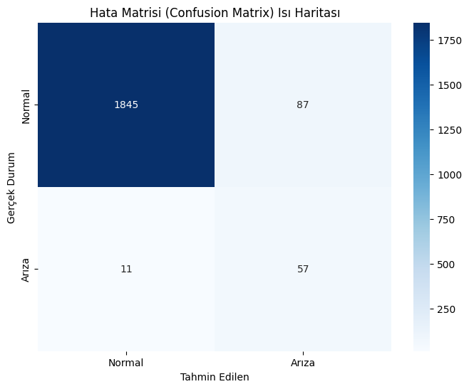
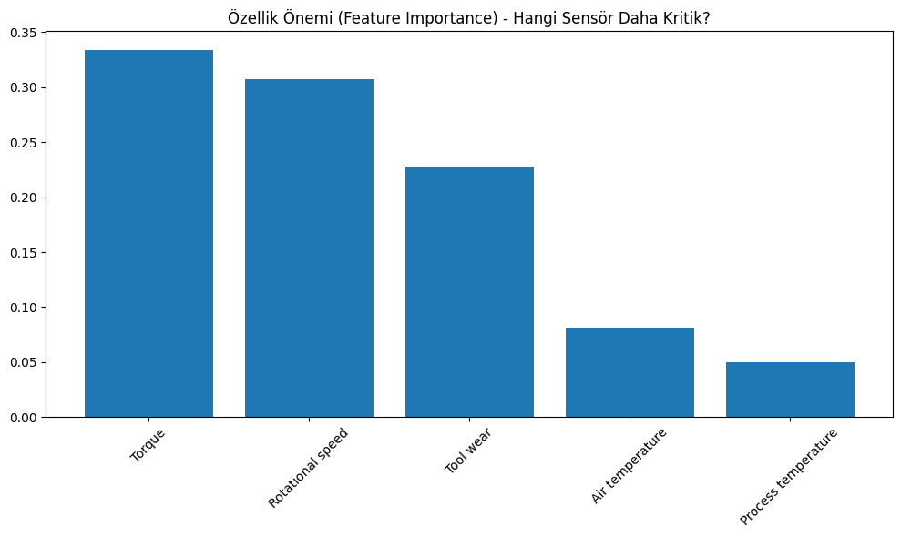
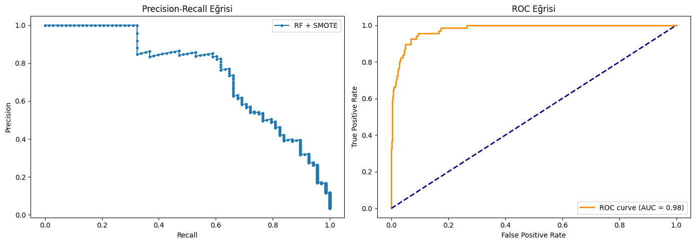
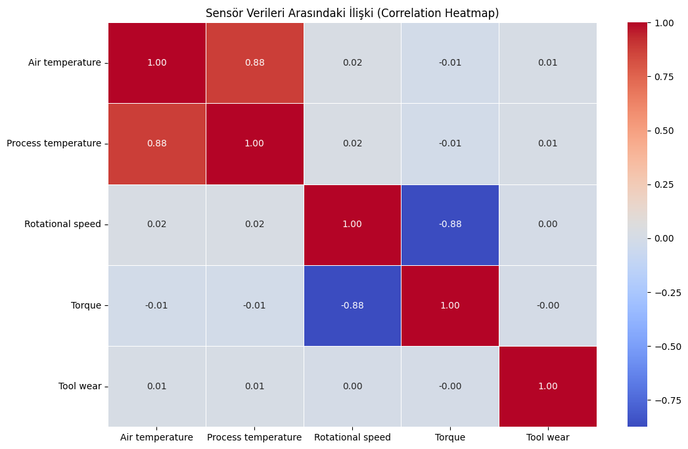

# Predictive Maintenance: Sınıf Dengesizliği Altında Makine Arıza Tahmini

AI4I 2020 Predictive Maintenance veri seti üzerinde **SMOTE + Random Forest** ile makine arızalarını tahmin eden bir veri madenciliği projesidir. Ostim Teknik Üniversitesi, Yapay Zeka Mühendisliği, Veri Madenciliği dersi final projesi olarak hazırlanmıştır.

## 📌 Problem

Endüstriyel verilerde arızalar normal çalışmaya göre çok nadirdir. Bu veri setinde arıza oranı yalnızca **%3.4**'tür. Bu yüzden standart modeller arızaları büyük ölçüde kaçırır ve *accuracy* yanıltıcı olur. Projede asıl hedef, arızaların ne kadarının yakalandığını gösteren **Recall** değerini artırmaktır.

## 📂 Veri Seti

- **Kaynak:** [AI4I 2020 Predictive Maintenance Dataset – UCI](https://archive.ics.uci.edu/dataset/601/ai4i+2020+predictive+maintenance+dataset)
- **Boyut:** 10.000 örnek, 14 sütun
- **Kullanılan özellikler:** hava sıcaklığı, proses sıcaklığı, dönüş hızı, tork, takım aşınması
- **Hedef:** `Machine failure` (0 = normal, 1 = arıza)
- **Çıkarılan sütunlar:** `UDI`, `Product ID`, `Type`

Notebook veriyi `ucimlrepo` ile doğrudan UCI'dan çeker (internet gerekir). İnternet yoksa aynı veri `data/ai4i2020.csv` olarak yedek halde bulunur.

## 🧠 Yöntem

1. Eğitim/test ayrımı: %80 / %20 (stratified, `random_state=42`)
2. `StandardScaler` ile standardizasyon
3. SMOTE (**yalnızca eğitim setine** uygulanır): 7.729 normal / 271 arıza → 7.729 / 7.729
4. Üç model karşılaştırması: Lojistik Regresyon, Random Forest (SMOTE'suz), Random Forest + SMOTE (`max_depth=10`)
5. `GridSearchCV` ile hiperparametre araması (en iyi: `max_depth=15`, `min_samples_split=2`, `n_estimators=100`)
6. Değerlendirme: Recall, Precision, F1, confusion matrix, ROC/AUC, 5-katlı Stratified K-Fold

## 📊 Sonuçlar (test seti, 2.000 örnek)

| Model | Recall | Precision | F1 |
|-------|:------:|:---------:|:--:|
| Lojistik Regresyon (baz) | 0.132 | 0.692 | 0.222 |
| Random Forest (SMOTE'suz) | 0.632 | 0.896 | 0.741 |
| **Random Forest + SMOTE** | **0.838** | 0.396 | 0.538 |

- SMOTE'lu model, 68 arızanın **57'sini** yakaladı (11 kaçırdı). Bedeli 87 yanlış alarm oldu.
- **ROC AUC = 0.98**
- 5-katlı CV Recall ortalaması 0.981. Bu değer SMOTE ile genişletilmiş eğitim seti üzerinde hesaplandığı için test seti sonuçlarından (0.838) yüksektir; genelleme performansı olarak test seti değerleri esas alınmalıdır.

**Özellik önem sırası (RF + SMOTE):** Tork (0.33) > Dönüş hızı (0.31) > Takım aşınması (0.23) > Hava sıcaklığı (0.08) > Proses sıcaklığı (0.05)

| | |
|---|---|
|  |  |
|  |  |

## 📁 Proje Yapısı

```
├── README.md
├── requirements.txt
├── LICENSE
├── .gitignore
├── data/
│   └── ai4i2020.csv
├── notebooks/
│   └── veri_madenciligi.ipynb
├── reports/
│   └── veri_madenciligi_raporu.pdf
└── results/
    ├── confusion_matrix.png
    ├── feature_importance.png
    ├── pr_roc_curves.png
    └── correlation_heatmap.png
```

## ⚙️ Kurulum ve Çalıştırma

```bash
git clone https://github.com/tahabahadirx/predictive-maintenance-data-mining.git
cd predictive-maintenance-data-mining
python -m venv venv
venv\Scripts\activate          # Windows (Linux/Mac: source venv/bin/activate)
pip install -r requirements.txt
jupyter notebook notebooks/veri_madenciligi.ipynb
```

## 📄 Rapor

Yöntem, bulgular ve tartışma için: [Proje Raporu (PDF)](reports/veri_madenciligi_raporu.pdf)

## 🔭 Gelecek Çalışmalar

ADASYN / GAN tabanlı sentetik veri, XGBoost / LightGBM karşılaştırması, SHAP ile yorumlanabilirlik, maliyet duyarlı öğrenme ve LSTM ile zaman serisi yaklaşımı.

## 👤 Yazar

**Taha Doğukan Bahadır** · [GitHub](https://github.com/tahabahadirx)

## 📜 Lisans

Kod MIT lisansı ile paylaşılmıştır. Veri seti UCI Machine Learning Repository'den alınmıştır (CC BY 4.0).
